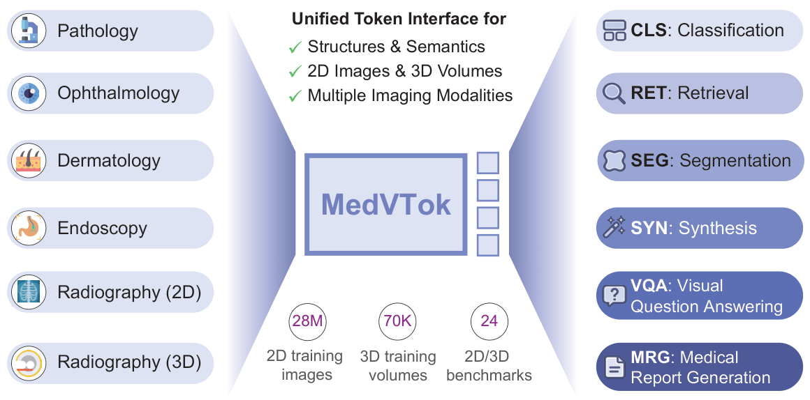
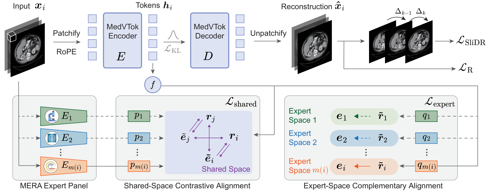

<div align="center">

# 🩺 MedVTok: A General-Purpose Medical Visual Tokenizer

**One token interface across medical imaging dimensions, modalities, and tasks.**

[](https://masaaki-75.github.io/medvtok/)
[](https://huggingface.co/massaki75/medvtok)
[](https://arxiv.org/abs/2610.35842)

</div>

<p align="center">
  
</p>

## 🔎 Overview

MedVTok encodes **2D medical images and 3D volumes into a unified token space**, preserving anatomical structure and clinical semantics. Trained on over 28M images and 70K volumes across 9 imaging modalities, it achieves state-of-the-art performance on 24 downstream benchmarks covering classification, retrieval, segmentation, synthesis, visual question answering, and report generation.


## 🧠 Method

- **Slice Differential Regularization (SliDR)** preserves inter-slice anatomical continuity through first- and second-order slice differences.
- **Multi-Expert Representation Alignment (MERA)** combines shared-space contrastive alignment with complementary alignment in each expert's native space.

A single transformer encoder-decoder produces global features, spatial patch tokens, and continuous Gaussian latents for downstream tasks and reconstruction.

<p align="center">
  
</p>

## 🚀 Getting Started

See **[GUIDELINE.md](GUIDELINE.md)** for environment setup, resource downloads, checkpoint paths, and data preparation. Download the [MedVTok checkpoint and configuration](https://huggingface.co/massaki75/medvtok) into `weights/` for inference, or pass the checkpoint's local path to `build_model`. The [demo notebook](demo.ipynb) includes complete 2D and 3D examples.

```bash
hf download massaki75/medvtok config.json ckpt.pth --local-dir weights
```

### 🖼️ Inference

```python
import torch
from PIL import Image
from models.medvtok import build_model, build_transform

device = "cuda" if torch.cuda.is_available() else "cpu"
model = build_model(
    arch="medvtok-clip-meanpool",
    pretrained_path="weights/ckpt.pth",
    device=device,
).eval()

transform = build_transform(image_shape=(256, 256))
image = transform(Image.open("data/vis_imgs/sample00.png").convert("RGB"))

with torch.inference_mode():
    outputs = model(
        [image.to(device)], sample_posterior=False,
        decode=True, return_batched_tensor=False,
    )

features = outputs["feats"]
patch_tokens = outputs["patch_tokens"]
latents = outputs["latent"]
reconstruction = outputs["recons"][0]
```

Inputs are normalized to `[-1, 1]`: `[3, H, W]` for images and `[3, D, H, W]` for volumes. Different input sizes are supported. Use `decode=False` for feature extraction without reconstruction.

<a id="training"></a>

## 🏋️ Training

Prepare CSVs and expert features following [GUIDELINE.md](GUIDELINE.md).

### 🖼️ Stage 1: 2D Pretraining

```bash
TRAIN_DATA=/path/to/train_2d.csv \
TRAIN_ROOT=/path/to/data \
FEATURE_ROOT="$PWD/outputs/alignment" \
NPROC_PER_NODE=1 \
bash scripts/training/train_stage1_full_mnodes.sh 1 10
```

Args: node count and per-GPU 2D batch size. Stage 1 starts from scratch unless a checkpoint is resumed with `RESUME_FROM`.

### 🧊 Stage 2: Joint 2D/3D Training

```bash
TRAIN_DATA=/path/to/train_2d.csv \
TRAIN_DATA_3D=/path/to/train_3d.csv \
TRAIN_ROOT=/path/to/data \
FEATURE_ROOT="$PWD/outputs/alignment" \
INIT_CKPT="$PWD/weights/ckpt.pth" \
NPROC_PER_NODE=1 \
bash scripts/training/train_stage2_full_mnodes.sh 1 10 2
```

Args: node count, per-GPU 2D batch size, and per-GPU 3D batch size. Both CSVs share `TRAIN_ROOT`; `INIT_CKPT` supplies the initial tokenizer weights.

Override loss weights with `LSHARE`, `LEXPERT`, and, in Stage 2, `LSLIDR`. Multi-node launches use `NPROC_PER_NODE`, `MASTER_ADDR`, `MASTER_PORT`, and `NODE_RANK`. Checkpoints are saved under `outputs/ckpts/` by default.

Both scripts default to the bundled CSVs and `TRAIN_ROOT=data/`. Adjust batch sizes to GPU memory: mixed-resolution training uses up to 512 pixels per side and can exceed 48 GiB per GPU with the example batch sizes. See [the setup guide](GUIDELINE.md#7-run-training) for a smaller Stage 1 run and Stage 2 memory settings.

### 🧬 Expert Features

| Domain | Expert |
| --- | --- |
| Dermoscopy | [DermLIP](https://github.com/SiyuanYan1/Derm1M) |
| Fundus photography | [RET-CLIP](https://github.com/sStonemason/RET-CLIP) |
| Histopathology | [CONCH v1.5](https://huggingface.co/MahmoodLab/conchv1_5) |
| Endoscopy / surgical images | [PeskaVLP](https://github.com/CAMMA-public/PeskaVLP) |
| 2D CT, MRI, ultrasound, X-ray, OCT | [MedImageInsight](https://github.com/microsoft/healthcareai-examples) |
| 3D CT | [SPECTRE](https://github.com/cclaess/SPECTRE) |
| 3D MRI | [HLIP](https://github.com/zch0414/hlip) |

Extract features with [extract_alignment_features.py](scripts/expert_feature_extraction/extract_alignment_features.py) for 2D data and [extract_alignment_features_3d.py](scripts/expert_feature_extraction/extract_alignment_features_3d.py) for 3D data. See [GUIDELINE.md](GUIDELINE.md) for downloads and commands. 

Feel free to try other expert models; stronger pretrained models may further improve MedVTok!

## 📁 Repository

```text
.
├── data/                           # Example CSVs and demo inputs
│   ├── examples_2d.csv             # Example 2D training metadata
│   ├── examples_3d.csv             # Example 3D training metadata
│   └── vis_imgs/                   # Demo images and volumes
├── datasets/                       # 2D/3D data loading
├── encoders/                       # Medical expert encoders
├── layers/                         # Model building blocks
├── models/                         # Tokenizer, wrapper, and discriminator
├── scripts/                        # Training launch and data preprocessing scripts
├── trainers/                       # Training loops and optimization
├── utilities/                      # Losses, configuration, and helpers
├── build_env.sh                    # Conda environment setup
├── local_constants.py              # Expert checkpoint paths
├── main.py                         # Training entry point
├── demo.ipynb                      # Inference examples
├── GUIDELINE.md                    # Setup and resource downloads
├── requirements.txt                # Python dependencies
├── LICENSE                         # MIT license for original contributions
└── README.md                       # Project overview
```

<a id="citation"></a>

## 📚 Citation

If you find our model and code useful in your research, please kindly cite our paper :)

```bibtex
@misc{ma2026medvtok,
  title  = {MedVTok: A General-Purpose Medical Visual Tokenizer},
  author = {Ma, Chenglong and Ji, Yuanfeng and Ning, Junzhi and Liu, Jiyao and Wei, Yujie and Rui, Shaohao and Zhang, Chaoyang and Li, Wenjie and Tang, Wenhao and Tang, Cheng and Li, Wei and Gao, Shujian and Zhang, Yujie and Chen, Ying and Li, Zilong and Ge, Zongyuan and Song, Diping and Ye, Jin and Hu, Ming and He, Junjun and Shan, Hongming},
  year   = {2026},
  eprint = {2610.35842},
  archivePrefix = {arXiv},
  url    = {https://arxiv.org/abs/2610.35842}
}
```

## 🙏 Acknowledgments and License

We thank the teams behind [DermLIP](https://github.com/SiyuanYan1/Derm1M), [RET-CLIP](https://github.com/sStonemason/RET-CLIP), [CONCH v1.5](https://github.com/mahmoodlab/TITAN), [PeskaVLP](https://github.com/CAMMA-public/PeskaVLP), [MedImageInsight](https://github.com/microsoft/healthcareai-examples), [SPECTRE](https://github.com/cclaess/SPECTRE), [HLIP](https://github.com/zch0414/hlip), [MedVAE](https://github.com/StanfordMIMI/MedVAE), and [AToken](https://github.com/apple-aiml-research/ml-atoken) for their open-source contributions. The code for training MedVTok is adapted from [MedITok](https://github.com/Masaaki-75/meditok) and [UniTok](https://github.com/FoundationVision/UniTok). 
Check out these amazing works, too!

This project is released under the [MIT License](LICENSE); third-party code and resources retain their respective licenses.
